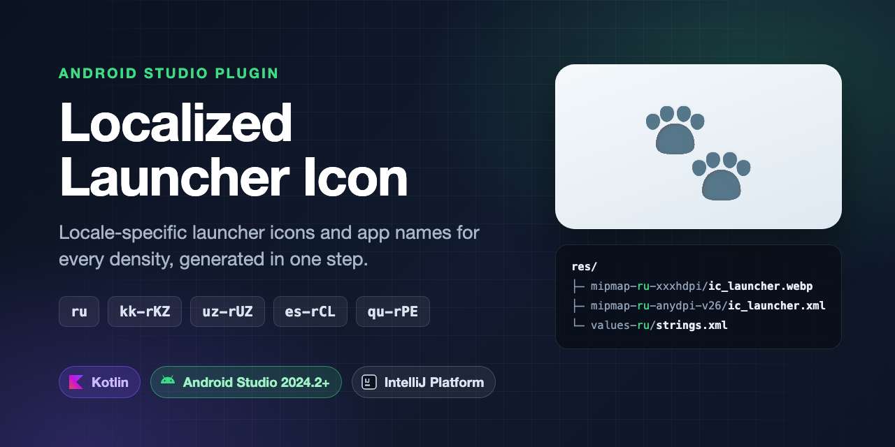
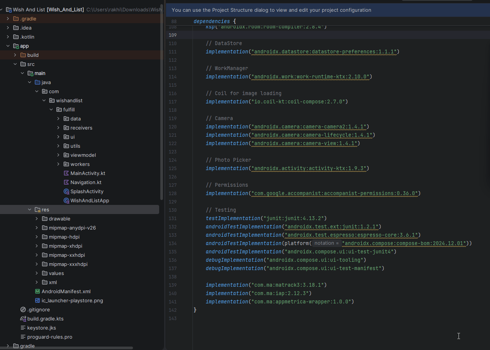

<p align="center"></p>

# Localized Launcher Icon

[](https://github.com/Pobiwan007/LocalizedLauncherIcon/actions/workflows/ci.yml)
[](https://github.com/Pobiwan007/LocalizedLauncherIcon/releases)


[](https://pinterest.github.io/ktlint/)

An Android Studio plugin that generates **locale-specific launcher icons and app names** in one step.
Useful when an app needs a different icon or name per market (e.g. a localized logo for `ru`, `kk-rKZ`
and `uz-rUZ`), which Android Studio's Image Asset wizard cannot do.

## 🖼️ Demo



## 🚀 Features

- Full launcher icon set for every density (`mdpi` … `xxxhdpi`) and every selected locale:
  - `ic_launcher` (48 dp, rounded square) and `ic_launcher_round` (48 dp, circle)
  - `ic_launcher_foreground` / `ic_launcher_background` adaptive layers (108 dp)
  - `mipmap-<locale>-anydpi-v26/ic_launcher.xml` and `ic_launcher_round.xml`
- Localized `app_name` in `values-<locale>/strings.xml`: creates the file, replaces an existing entry or
  appends one, with correct escaping of `'`, `&`, `<`, `@` and so on
- Many locales at once: `es-rCL, es-rAR, es-rPE, qu-rPE`
- Runs as a cancellable background task with progress and a result notification, then refreshes the project tree
- Anti-aliased round/rounded edges; WebP output when the IDE supports it, PNG otherwise

## 🛠️ Installation

### From GitHub Releases

1. Download `LocalizedLauncherIcon-x.y.z.zip` from [Releases](https://github.com/Pobiwan007/LocalizedLauncherIcon/releases)
   (or the `LocalizedLauncherIcon-plugin` artifact of the latest CI run).
2. **Settings → Plugins → ⚙️ → Install Plugin from Disk…** and select the ZIP.
3. Restart the IDE.

### JetBrains Marketplace

> Coming soon…

## 🧪 How to use

1. In the Project view, right-click a module's **`res`** folder → **New → Create Localization**.
2. Enter one or more locales: `ru`, `kk-rKZ` or `es-rCL, es-rAR, qu-rPE`.
3. Tick **Add localized launcher icons** and pick the foreground and background images (PNG / WebP / JPEG),
   and/or tick **Add localized app name** and type the name.
4. Press **OK**. Files are generated in the background and the `res` folder is refreshed.

## 🏗️ How it works

```
action/CreateLocalizationAction      New → Create Localization (enabled only on res/)
        │
ui/CreateLocalizationDialog          Kotlin UI DSL form, field + cross-field validation
        │  builds a LocalizationRequest
task/GenerateLocalizationTask        Task.Backgroundable: progress, cancellation, VFS refresh, notification
        │
generation/LocalizationGenerator     platform-free orchestration (unit-tested)
        ├── LauncherIconGenerator    Java2D: scale, compose, anti-aliased mask → mipmap-<locale>-<density>/
        └── AppNameGenerator         values-<locale>/strings.xml (escape + upsert app_name)
validation/                          pure locale, resource-name and form rules (unit-tested)
```

- **Layering.** Only `action`, `ui` and `task` touch IntelliJ Platform APIs. Generation and validation are plain
  Kotlin, so they are tested with JUnit and temporary folders, without starting an IDE.
- **Threading.** The dialog runs on the EDT; generation runs in a `Task.Backgroundable` through
  `runBlockingCancellable`, so cancelling the progress cancels the coroutines. Icons for all locales and densities
  are rendered concurrently on `Dispatchers.IO`.
- **File system.** Files are written with `java.io` and the `res` folder is refreshed through the VFS once at the
  end (also after a failure or cancellation), instead of a write action per file.

## 👩‍💻 Development

Requirements: JDK 17+ (CI uses 21). The Gradle wrapper downloads everything else, including IntelliJ IDEA Community
to compile against.

```bash
./gradlew ktlintCheck test          # lint + unit tests
./gradlew buildPlugin               # installable ZIP in build/distributions
./gradlew runIde                    # sandbox IntelliJ IDEA Community with the plugin
./gradlew runIde -PlocalIdePath="/Applications/Android Studio.app/Contents"   # your local Android Studio
./gradlew ktlintFormat              # auto-format
```

Tip: put `localIdePath=...` into `~/.gradle/gradle.properties` to make it the default on your machine.

The plugin runs on the Kotlin stdlib bundled with the IDE, so the Kotlin `apiVersion` is pinned to the version shipped
with the oldest supported platform (`pluginSinceBuild` in `gradle.properties`).

CI (GitHub Actions) runs lint, tests, `buildPlugin` and `verifyPluginStructure` on every push and pull request, and
attaches the plugin ZIP to the GitHub release for `v*` tags.

See [CHANGELOG.md](CHANGELOG.md) for release notes.
